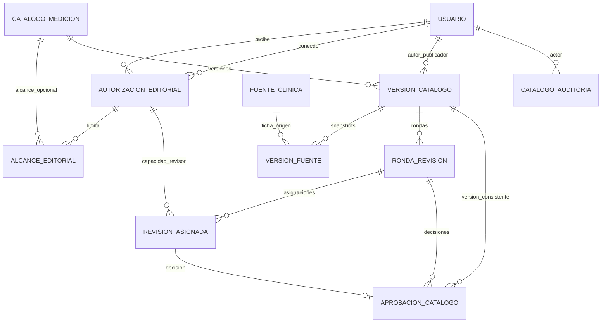

# Catálogo editorial clínico (migración 004)

## Alcance

La migración 004 incorpora únicamente el gobierno editorial de catálogos, versiones, fuentes, autorizaciones, rondas, decisiones y auditoría. No agrega pacientes, mediciones, diagnósticos, objetivos, criterios clínicos, umbrales ni alertas. No modifica las 13 tablas existentes ni activa el evaluador o el Outbox.

La concesión de autorizaciones por una cuenta administradora activa es una decisión operativa provisional de este prototipo. El rol de administrador no otorga capacidad de autor, revisor, coordinador o publicador automáticamente y esta autorización no constituye validación profesional o institucional del contenido.

## Entidades y relaciones

Los IDs que referencian `usuario.id_usuario` son `integer`, confirmado en `schema.sql`. Nuevas PK son `integer GENERATED BY DEFAULT AS IDENTITY`. Los snapshots de `version_fuente` duplican metadatos de la ficha intencionalmente para preservar la cita histórica.

## Estados y permisos

| Entidad | Estados | Capacidad responsable |
|---|---|---|
| Catálogo | borrador, activo, retirado | Autor crea; publicador activa/publica; publicador retira. |
| Versión | borrador, en_revision, aprobada, vigente, sustituida, retirada, cancelada | Autor crea; coordinador abre/cierra ronda; publicador publica. Cambios sustantivos después de enviar a revisión requieren versión nueva. |
| Fuente | pendiente_revision, vigente, revision_necesaria, retirada | Autor registra; coordinador documenta revisión/retirada dentro de alcance editorial. Sólo fuentes vigentes son publicables. |
| Autorización | activa, revocada (vencimiento calculado por vigencia) | Administrador activo concede/revoca; el concesionario no puede ser el actor. Renovar crea otro registro. |
| Ronda | abierta, cerrada, cancelada | Coordinador con alcance. Una ronda cerrada no se reabre. |
| Revisión asignada | asignada, en_revision, completada, retirada | Coordinador asigna; el revisor completa con su decisión. Un revisor por ronda. |
| Aprobación | aprobada, rechazada, requiere_cambios | Una fila inmutable por revisor/ronda. Corrección requiere nueva ronda. |

La política provisional exige dos aprobaciones, cero rechazos o solicitudes de cambio, autor distinto de revisores y publicador distinto de autor/revisores. Es una regla técnica provisional, no estándar clínico. El quorum está parametrizado por el constructor del repositorio (`aprobacionesRequeridas`, mínimo 2; valor por defecto 2). Cada concesión tiene capacidades y alcances normalizados por tipo de contenido, catálogo, enfermedad y población. `NULL` en una dimensión significa alcance general de esa dimensión y requiere una concesión explícita.

## Flujo de autorización

1. Administrador activo concede una capacidad a un usuario activo diferente de sí mismo, con inicio/fin y uno o más alcances.
2. La aplicación almacena concesión, alcance y auditoría en la misma transacción.
3. La DB vuelve a verificar administrador activo y evita autoconcesión en el trigger.
4. En cada operación se comprueban usuario activo, estado de autorización, vigencia, capacidad y alcance.
5. Revocar registra actor, hora y motivo; no borra ni reactiva el registro. Renovar requiere autorización nueva.

## Flujo de revisión y publicación

1. Autor crea catálogo/versión borrador y registra fuente.
2. Autor asocia fuente; el adaptador copia snapshots bibliográficos y hash opcional.
3. Coordinador envía la versión a revisión y asigna revisores activos autorizados en alcance.
4. Cada revisor asignado registra una decisión una sola vez en esa ronda. Trigger y UNIQUE impiden decisión sin asignación, autorización vigente, usuario activo, alcance correcto, autoría propia o duplicado.
5. Coordinador cierra cuando no quedan asignaciones pendientes. Si reúne la política provisional favorable, versión queda aprobada.
6. `PublicarVersionCatalogo` inicia transacción, bloquea catálogo y versión, valida ronda/aprobaciones/revisores/fuentes/alcances, reemplaza la versión vigente, registra actor/fecha en auditoría y hace commit. Error implica rollback completo.
7. La publicación serializa por fila de catálogo y un índice parcial garantiza como defensa final una sola versión vigente.

## API

Todas las mutaciones requieren JWT activo y CSRF. El actor siempre sale del JWT; se descartan `actorId`/`idUsuarioActor` del body.

| Método y ruta | Capacidad/rol |
|---|---|
| `GET /api/editorial/catalogos` | Sesión activa; sólo catálogos no retirados y su versión vigente. |
| `POST /api/editorial/catalogos` | `autor` con alcance. |
| `POST /api/editorial/catalogos/:id/versiones` | `autor` con alcance. |
| `POST /api/editorial/fuentes` | `autor` con alcance de fuente. |
| `PATCH /api/editorial/fuentes/:id/estado` | `coordinador` con alcance de fuente. |
| `POST /api/editorial/versiones/:id/fuentes` | `autor` con alcance; versión en borrador. |
| `POST /api/admin/editorial/autorizaciones` | Rol `administrador` activo; concede capacidad, alcance y vigencia a otro usuario. |
| `GET /api/admin/editorial/autorizaciones` | Administrador activo. |
| `PATCH /api/admin/editorial/autorizaciones/:id/revocar` | Administrador activo; motivo obligatorio. |
| `POST /api/editorial/versiones/:id/solicitar-revision` | `coordinador` con alcance. |
| `POST /api/editorial/rondas/:id/asignaciones` | `coordinador` con alcance; body `revisores: [{idUsuario}]`. |
| `POST /api/editorial/rondas/:id/decisiones` | Revisor asignado con autorización/alcance vigente. |
| `POST /api/editorial/rondas/:id/cerrar` | `coordinador` con alcance y cero revisiones pendientes. |
| `POST /api/editorial/versiones/:id/publicar` | `publicador` con alcance; transaccional. |
| `POST /api/editorial/catalogos/:id/retirar` | `publicador` con alcance y motivo. |
| `GET /api/editorial/catalogos/:id/versiones`, `GET /api/editorial/versiones/:id/fuentes` | `coordinador` con alcance. |
| `GET /api/editorial/auditoria` | Capacidad editorial; revisar alcance de lectura antes de despliegue. |

## Fechas y snapshots

Nuevos instantes de auditoría usan `timestamptz`; fechas de publicación documental y revisión planificada usan `date`. Las 13 tablas existentes, incluidas columnas `timestamp without time zone`, quedan intactas. La interfaz renderiza instantes en zona de aplicación configurada; no se reinterpretan timestamps históricos sin zona. Snapshot conserva institución, título, identificador, versión documental, fecha de publicación, población, URL, sección/página, fecha de captura y SHA-256 opcional. No se descargan documentos ni se copian contenidos protegidos.

## Migración y rollback

`migrations/004_catalogo_editorial.up.sql` comprueba las 13 tablas base y el tipo `usuario.id_usuario`; crea sólo objetos nuevos dentro de transacción. No se ejecuta automáticamente desde el backend: el repositorio no contiene runner de migraciones.

`migrations/004_catalogo_editorial.down.sql` aborta si cualquier tabla nueva contiene datos y sólo entonces elimina triggers, funciones y tablas creadas por 004. No toca las 13 tablas existentes. Antes de rollback futuro se requiere backup verificado y autorización explícita para perder datos editoriales.

Para aplicar en otro entorno, revisar primero DDL/hash del esquema destino y respaldo verificado. Después, con autorización del responsable de esa base, ejecutar desde el directorio `backend` con una conexión seleccionada explícitamente: `psql -d <base_destino> -v ON_ERROR_STOP=1 -f migrations/004_catalogo_editorial.up.sql`. El archivo contiene su propia transacción. No aplicar el archivo DOWN como procedimiento normal de reversión: aborta con datos; si alguna vez se requiere, usar sólo tras exportación y autorización explícita.

### Estado de la base local de desarrollo (3 nov 2026)

La migración UP 004 se aplicó manualmente a `seguimiento_cronicos` en el contenedor local `seguimiento-cronicos-db` (PostgreSQL 18.6), tras generar y validar un respaldo completo con `pg_restore -l`. Respaldo: `/home/bh509/backups/seguimiento_cronicos_pre_004_20261103_234243.dump`. La migración creó las 10 tablas editoriales; el esquema quedó en 23 tablas, 249 restricciones, 62 índices y 22 triggers. No se aplicaron las migraciones 001–003.

Las 13 tablas originales conservaron sus filas: se compararon hashes deterministas de todas las filas contra el respaldo previo y coincidieron las 13/13. UP no escribió en tablas anteriores. DOWN se probó solamente en una instancia PostgreSQL desechable y no se ejecutó en la base local principal.

## Pruebas y límites

Se agregaron pruebas unitarias del dominio/caso de uso, concesión y autoconcesión, autorización expirada/revocada/inactiva/fuera de alcance, publicación con quorum, rechazo por quorum insuficiente, actor derivado de sesión, conflictos de revisión/publicación y aserciones estructurales de migración. La suite backend ejecutada: **39/39 aprobadas**. El build frontend ejecutado: **Vite build exitoso**.

La prueba `tests/catalogo-editorial-postgres.integration.sql` cubre 19 invariantes de autorización, alcance, vigencia, rondas, decisiones, snapshots e índice de versión vigente. Tiene una guarda que exige la DB temporal vacía `catalogo_editorial_test` y termina en `ROLLBACK`. `tests/catalogo-editorial-publicacion.integration.mjs` y su fixture prueban el adaptador real contra PostgreSQL: dos publicaciones concurrentes quedan serializadas con una sola versión vigente, y un error inducido al guardar auditoría revierte la publicación completa. Ambos conjuntos se ejecutaron en contenedores PostgreSQL 18.6 desechables sin volúmenes; se eliminaron al finalizar.

En la base local principal no se insertaron filas editoriales. No se creó ningún usuario nuevo. El evaluador automático no se ejecutó y no hay triggers añadidos a `medicion`, `alerta` u `outbox_evento`; AlertEvaluator y Outbox worker permanecen desactivados. No se ejecutaron workflows n8n.

El runtime Linux de WSL no tiene `node` disponible; las pruebas y el build se ejecutaron con Node.js 24.22.1 incluido por Codex. Para operar el backend desde WSL, instalar/configurar Node.js 20 o superior y npm; alternativamente, iniciar desde PowerShell con Node.js instalado en Windows.

La autorización concedida por administrador es provisional y no valida competencia profesional. No se implementan decisiones médicas. La lista de fuentes, criterios, umbrales, diagnósticos y alertas queda fuera del alcance.
